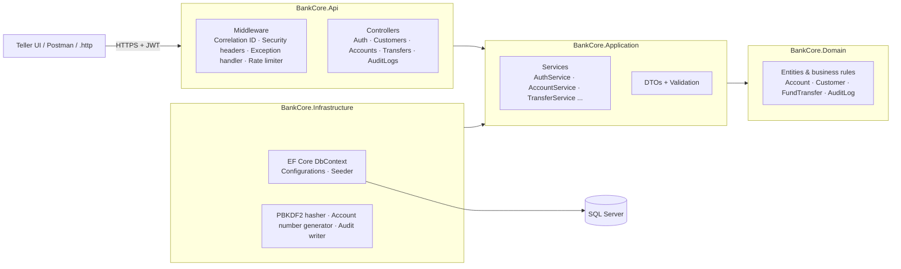

# BankCore API – Core Banking Accounts & Fund Transfer Service

A secure REST API for the day-to-day operations of a retail bank branch: customer onboarding,
savings/current accounts, cash deposits and withdrawals, internal fund transfers, account
statements and a full audit trail. Built with **ASP.NET Core Web API, C#, Entity Framework Core
and SQL Server**, following clean architecture, OWASP secure-coding practices and banking-grade
rules such as idempotent transfers, optimistic concurrency and segregation of duties.

> Portfolio project 1 of 5 – banking & payments systems on .NET.

---

## Table of contents
- [Highlights](#highlights)
- [Architecture](#architecture)
- [Tech stack](#tech-stack)
- [Getting started](#getting-started)
- [Demo users & data](#demo-users--data)
- [API reference](#api-reference)
- [Banking rules implemented](#banking-rules-implemented)
- [Security (OWASP)](#security-owasp)
- [Database & T-SQL](#database--t-sql)
- [Testing](#testing)
- [Design decisions](#design-decisions)
- [Roadmap](#roadmap)

---

## Highlights

| Area | What is implemented |
|---|---|
| **Accounts** | Customer onboarding with Sri Lankan NIC validation (old & new formats), Savings/Current accounts, Luhn-checked 12-digit account numbers, freeze / unfreeze / close lifecycle |
| **Transactions** | Cash deposit & withdrawal, immutable double-entry style ledger with running balance |
| **Fund transfers** | Atomic debit + credit, **Idempotency-Key** support (safe retries), single & daily limits on the Sri Lanka business day (UTC+05:30) |
| **Statements** | Period statement with opening balance, total credits/debits, closing balance and paging |
| **Concurrency** | Optimistic concurrency token on accounts – no lost updates when two tellers act at once |
| **Security** | JWT bearer auth, role-based policies (Admin / Teller / Auditor), PBKDF2 password hashing, account lockout, login rate limiting, secure headers |
| **Audit** | Every business action and login attempt is written to an append-only audit log in the **same DB transaction** as the change, with user, IP and correlation ID |
| **Operations** | RFC 9457 ProblemDetails errors, correlation IDs, structured logging, health checks, Docker, GitHub Actions CI |
| **SQL Server** | EF Core code-first model + hand-written stored procedures for statements, EOD summary, dormant accounts and balance reconciliation |

---

## Architecture



**Dependency rule:** `Domain` has no dependencies. `Application` depends only on `Domain`
(+ EF Core abstractions). `Infrastructure` implements the Application interfaces. `Api` is the
composition root.

```
BankCore/
├── src/
│   ├── BankCore.Domain/          # Entities, business rules, domain exceptions (no dependencies)
│   ├── BankCore.Application/     # Use cases (services), DTOs, validation, interfaces
│   ├── BankCore.Infrastructure/  # EF Core, SQL Server/SQLite, hashing, audit, seeding
│   └── BankCore.Api/             # Controllers, JWT auth, policies, middleware, Program.cs
├── tests/BankCore.Tests/         # Unit + SQLite-backed service tests + full API integration tests
├── database/                     # T-SQL stored procedures, view and sample queries
├── .github/workflows/ci.yml      # Build, test, coverage, Docker build
├── Dockerfile · docker-compose.yml
└── BankCore.slnx
```

---

## Tech stack

- **C# / .NET 10**, ASP.NET Core Web API (controllers)
- **Entity Framework Core 10** – SQL Server (production) and SQLite (tests / quick demo)
- **SQL Server 2022**, T-SQL stored procedures and views
- **JWT** bearer authentication, policy-based authorization, built-in rate limiting
- **OpenAPI** document + Scalar API explorer (Development)
- **xUnit**, `WebApplicationFactory` integration tests, Coverlet coverage
- **Docker**, Docker Compose, **GitHub Actions** CI

---

## Getting started

### Prerequisites
- [.NET 10 SDK](https://dotnet.microsoft.com/download)
- One of: SQL Server LocalDB (installed with Visual Studio), Docker Desktop, or nothing at all (SQLite option)

### Option A – Visual Studio / LocalDB (Windows)
```bash
git clone https://github.com/YOUR-GITHUB-USERNAME/BankCore.git
cd BankCore
dotnet run --project src/BankCore.Api
```
Open **http://localhost:5080/scalar** for the API explorer. The database `BankCoreDb` is created
and seeded automatically in Development.

### Option B – Docker (any OS, real SQL Server)
```bash
docker compose up --build
```
API: **http://localhost:8080/scalar** · SQL Server: `localhost,1433` (user `sa`, password in `docker-compose.yml`).

### Option C – No SQL Server (SQLite)
```bash
dotnet run --project src/BankCore.Api -- \
  --Database:Provider=Sqlite \
  --ConnectionStrings:BankCore="Data Source=bankcore.db"
```

### Trying the API
The fastest way is **`src/BankCore.Api/BankCore.Api.http`** (Visual Studio, Rider or VS Code
REST Client): it logs in, makes deposits and transfers, pulls a statement and reads the audit log.

With curl:
```bash
TOKEN=$(curl -s http://localhost:5080/api/v1/auth/login \
  -H "Content-Type: application/json" \
  -d '{"username":"teller","password":"Demo@12345"}' | jq -r .token)

curl -s http://localhost:5080/api/v1/transfers \
  -H "Authorization: Bearer $TOKEN" -H "Content-Type: application/json" \
  -H "Idempotency-Key: $(uuidgen)" \
  -d '{"fromAccountNumber":"001000000016","toAccountNumber":"001000000032","amount":2500,"narration":"Test"}'
```

### Configuration & secrets
Never commit real secrets. For anything beyond local development set them with user-secrets or
environment variables:
```bash
cd src/BankCore.Api
dotnet user-secrets set "Jwt:SigningKey" "<at least 32 random characters>"
dotnet user-secrets set "ConnectionStrings:BankCore" "<connection string>"
```
| Key | Purpose | Default |
|---|---|---|
| `Database:Provider` | `SqlServer` or `Sqlite` | `SqlServer` |
| `Jwt:SigningKey` | HMAC key (≥ 32 bytes) – startup fails if missing | – |
| `Jwt:ExpiryMinutes` | Access token lifetime | 30 |
| `TransferLimits:SingleTransferLimit` | Max single transfer (LKR) | 500,000 |
| `TransferLimits:DailyTransferLimit` | Max outgoing per account per business day (LKR) | 1,000,000 |
| `Security:MaxFailedLoginAttempts` / `LockoutMinutes` | Brute-force lockout | 5 / 15 |
| `RateLimiting:LoginPermitLimitPerMinute` | Login requests per IP per minute | 5 |
| `Seed:Enabled` | Seed demo data (Development only) | false |

---

## Demo users & data

Seeded only when `Seed:Enabled=true` (Development / Docker). Password for all: **`Demo@12345`**

| Username | Role | Can do |
|---|---|---|
| `teller` | Teller | Onboard customers, open accounts, deposit, withdraw, transfer, view |
| `admin` | Admin | Onboard customers, open accounts, freeze / unfreeze / close accounts, view, read audit log – **cannot move money** |
| `auditor` | Auditor | Read-only: accounts, statements, audit log |

| Account | Owner | Type | Opening balance (LKR) |
|---|---|---|---|
| `001000000016` | Kasun Perera | Savings | 250,000.00 |
| `001000000024` | Nimali Fernando | Savings | 75,000.00 |
| `001000000032` | Kasun Perera | Current | 1,000,000.00 |

---

## API reference

All endpoints are versioned under `/api/v1` and require a bearer token unless stated otherwise.

| Method | Endpoint | Policy | Description |
|---|---|---|---|
| POST | `/auth/login` | Anonymous, rate-limited | Get a JWT |
| POST | `/customers` | Admin, Teller | Onboard a customer |
| GET | `/customers/{id}` | Admin, Teller, Auditor | Customer with accounts |
| GET | `/customers?search=&page=&pageSize=` | Admin, Teller, Auditor | Search by name / NIC / CIF |
| POST | `/accounts` | Admin, Teller | Open account (optional initial deposit) |
| GET | `/accounts/{accountNumber}` | Admin, Teller, Auditor | Account and balance |
| POST | `/accounts/{accountNumber}/deposits` | Teller | Cash deposit |
| POST | `/accounts/{accountNumber}/withdrawals` | Teller | Cash withdrawal |
| POST | `/accounts/{accountNumber}/freeze` · `/unfreeze` · `/close` | Admin | Account lifecycle |
| GET | `/accounts/{accountNumber}/statement?from=&to=&page=&pageSize=` | Admin, Teller, Auditor | Statement (dates `yyyy-MM-dd`, Sri Lanka time) |
| POST | `/transfers` + header `Idempotency-Key` | Teller | Internal fund transfer |
| GET | `/audit-logs?action=&actor=&fromUtc=&toUtc=` | Admin, Auditor | Audit trail |
| GET | `/health` | Anonymous | Liveness + database check |

### Error format
Every error is an RFC 9457 `application/problem+json` response with a machine-readable code
and the correlation ID for support:
```json
{
  "type": "https://tools.ietf.org/html/rfc9110#section-15.5.21",
  "title": "Insufficient funds",
  "status": 422,
  "detail": "Account ********0024 has insufficient funds.",
  "instance": "/api/v1/accounts/001000000024/withdrawals",
  "errorCode": "INSUFFICIENT_FUNDS",
  "correlationId": "3f2a9c0e8b1d4f6a9e7c5b3a1d0f2e4c"
}
```
| Status | When |
|---|---|
| 400 | Request validation failed (e.g. invalid NIC, missing Idempotency-Key) |
| 401 / 403 | Not authenticated / role not allowed |
| 404 | Customer or account not found |
| 409 | Duplicate NIC, concurrency conflict, Idempotency-Key reused with a different payload |
| 422 | Business rule violated (insufficient funds, frozen account, limit exceeded …) |
| 429 | Too many login attempts |

---

## Banking rules implemented

- **Money** is `decimal(18,2)` end to end; amounts must be positive with at most 2 decimal places.
- **Ledger:** balances only change through `Account` methods, and every change writes an
  immutable `AccountTransaction` row carrying the running balance (`BalanceAfter`).
- **Atomic transfers:** debit, credit, both ledger rows, the transfer header and the audit row are
  saved in one `SaveChanges` call → one database transaction. Both legs are validated before
  anything is mutated.
- **Idempotency:** the client sends an `Idempotency-Key`. A retry with the same key returns the
  original transfer (`200 OK`, `isReplay: true`) instead of moving money twice. A unique index on
  the key is the backstop if two identical requests race. Re-using a key with a different payload → `409`.
- **Limits:** per-transfer limit and a daily outgoing limit that resets at midnight **Sri Lanka time**.
- **Optimistic concurrency:** `Account.ConcurrencyStamp` is rotated on every change; a stale
  update fails with `409` instead of silently overwriting another teller's work.
- **Account lifecycle:** frozen accounts cannot transact; only zero-balance accounts can be closed.
- **Segregation of duties:** Admins cannot post transactions; Auditors are read-only.
- **KYC basics:** Sri Lankan NIC validation (9 digits + V/X, or 12 digits; day-of-year 1–366 or 501–866),
  one customer per NIC, Sri Lankan mobile number format.

---

## Security (OWASP)

| Risk | Mitigation in this project |
|---|---|
| Broken access control | Fallback policy requires authentication everywhere; role policies per endpoint |
| Cryptographic failures | PBKDF2-HMAC-SHA512, 210k iterations, random salt, constant-time compare; signing key never committed, validated at startup |
| Injection | EF Core parameterised queries only; stored procedures use typed parameters |
| Identification & auth failures | Account lockout after 5 failures, per-IP login rate limiting, generic error messages, equal-time response for unknown users, short-lived JWTs |
| Security misconfiguration | `X-Content-Type-Options`, `X-Frame-Options`, `Referrer-Policy`, CSP and `Cache-Control: no-store` on API responses; HSTS outside Development |
| Logging & monitoring failures | Audit trail of all business actions and login attempts; correlation IDs on logs, responses and audit rows; account numbers masked in logs |
| Information disclosure | Global exception handler – no stack traces or SQL errors returned to clients |

---

## Database & T-SQL

The schema is created by EF Core (code-first, Fluent API configurations in
`src/BankCore.Infrastructure/Persistence/Configurations`). Key design points: unique indexes on
`AccountNumber`, `Nic`, `IdempotencyKey`; composite index `(AccountId, CreatedAtUtc)` for
statements and daily limits; `DECIMAL(18,2)` for money; enums stored as readable strings.

`database/01_StoredProcedures.sql` adds reporting objects for SQL Server:

| Object | Purpose |
|---|---|
| `dbo.usp_GetAccountStatement` | Statement header (opening/closing, totals) + line items |
| `dbo.usp_GetDailyTransactionSummary` | End-of-day summary by transaction type for a Sri Lanka business date |
| `dbo.usp_GetDormantAccounts` | Active accounts with no activity for N days |
| `dbo.vw_BalanceReconciliation` | Integrity check – account balance vs. latest ledger balance (should be empty) |

### Migrations
On first run the app creates the schema automatically. To switch to EF Core migrations:
```bash
dotnet tool install --global dotnet-ef
# drop the auto-created database first, then:
dotnet ef migrations add InitialCreate \
  --project src/BankCore.Infrastructure \
  --startup-project src/BankCore.Api \
  --output-dir Persistence/Migrations
```
Once migrations exist, startup applies them automatically on SQL Server.

---

## Testing

```bash
dotnet test
```

| Suite | What it covers |
|---|---|
| `Domain/*` | Account rules (balances, decimals, freeze, close, concurrency stamp), NIC validation, Luhn, masking, password hashing |
| `Application/TransferServiceTests` | Real SQLite database: atomic transfer, idempotent retry, key reuse conflict, insufficient funds rollback, daily limit and Sri Lanka midnight reset, frozen and unknown accounts |
| `Integration/ApiTests` | Whole HTTP pipeline via `WebApplicationFactory`: auth, 401/403 per role, deposits + statement reconciliation, idempotent transfer over HTTP, validation errors, security & correlation headers |

SQLite is used instead of the EF InMemory provider so that unique indexes, concurrency tokens and
transactions behave like a real relational database.

---

## Design decisions

- **Controllers over minimal APIs** – familiar to most enterprise .NET teams and easy to document per action.
- **Rich domain model** – business rules live in entities (`Account.Withdraw`, `Account.Close`), so they
  cannot be bypassed by a new endpoint.
- **Audit inside the unit of work** – audit rows are added to the same `DbContext` and committed with
  the business change, so there is never a transaction without an audit record.
- **UTC storage, Sri Lanka business day** – all timestamps are UTC; business-date rules (daily limit,
  statements, EOD report) convert using the fixed UTC+05:30 offset.
- **No hard deletes** – accounts are closed, not deleted; ledger and audit rows are append-only.

---

## Roadmap

- [ ] Refresh tokens and token revocation
- [ ] Maker-checker approval for high-value transfers
- [ ] Outbox pattern + message queue for notifications (SMS / email)
- [ ] OpenTelemetry tracing and metrics
- [ ] Interest calculation batch job for savings accounts

---

## License

MIT – see [LICENSE](LICENSE). Demo data uses fictitious names and NIC numbers.
